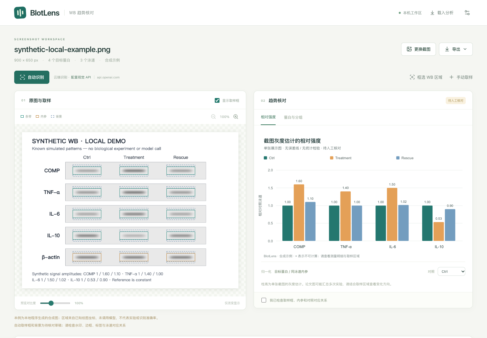

# BlotLens · WB 截图趋势核对

**简体中文** · [English](README.md) · [在线使用](https://blotlens.top/)

独立的本机网页工具：粘贴论文截图，由用户配置的视觉 API 提供条带和标签候选，本地程序按截图像素测量、扣背景、按内参与对照归一化，再生成可编辑、可复查的柱状图。

本应用是独立的 [BlotLens 项目](https://github.com/Gaoyuan-0423/blotlens)，可以单独安装、运行和发布。[WB 工作台](https://github.com/Gaoyuan-0423/blot-workbench) 引用固定版本的同一份代码，提供页面内的截图核对流程。它支持真实 PNG/JPEG 截图；输出是截图灰度估计，不生成统计检验或自动判定论文结论。



## 启动

在 BlotLens 仓库根目录使用 Node.js 22.12 或更新的兼容版本：

```sh
git clone https://github.com/Gaoyuan-0423/blotlens.git
cd blotlens
npm ci
npm run dev
```

打开终端打印的本机地址，默认 [http://127.0.0.1:4317](http://127.0.0.1:4317)。服务仅监听本机；关闭终端或按 Ctrl+C 停止。请使用 `127.0.0.1`，服务会拒绝其他 Host。

构建后运行：

```sh
npm run build
npm run start
```

如果端口已占用，可用环境变量 `REVIEWER_PORT` 指定另一个端口。macOS/Linux 示例：`REVIEWER_PORT=4319 npm run dev`。Windows PowerShell：先执行 `$env:REVIEWER_PORT=4319`，再运行启动命令。

## 使用

1. 选择、拖入或粘贴 PNG/JPEG 截图（15 MB、2000 万像素以内，单边不超过 16000 像素）。也可以先打开「合成示例」，它不调用模型。
2. 打开右上角 API 设置，填写 Base URL、视觉模型 ID 和 API Key。Base URL 是接口前缀，例如 `https://api.example.com/v1`，不要包含 `/chat/completions`；工具追加此路径。兼容本机 HTTP 模型服务，其他服务须使用 HTTPS。
3. 点击「自动识别」会发送整张导入截图；也可先「框选 WB 区域」，再点「识别框选区域」，仅发送选区。**图片会发往设置中显示的服务**。框选时尽量包含蛋白名和泳道标签；看不到的名称需手工补充。模型返回布局和标签，结果映射回原图，数值仍用原始像素在本地计算。再次识别同一选区会保留用户框入的标签范围。无 API 时点击「手动取样」生成网格。
4. 检查取样框。绿色为目标条带、橙色为内参、蓝色虚线为背景。点击框可拖动、拖右下角缩放，也可输入坐标。同一蛋白行宽高同步。按住 Shift、Ctrl 或 macOS 的 ⌘ 点击可多选／取消单个框；方向键将所选框整体移动 1 原图像素，Shift＋方向键移动 10 像素，拖动已选框可整体平移。到达图像边界时整组一起停止，框间距离保持不变。
5. 在「蛋白与分组」中修改名称、内参配对和缺失条带；新识别和新建布局的对照默认最左侧泳道，可以修改；载入文件保留保存的选择。手动新增泳道时自动默认会跟随最左位置，明确指定后不再随新增框改变。缺失／非正信号不会被补成 0 或伪造有效倍数。修改后立即重新计算并取消已复核状态。
6. 将柱状图与原截图中的论文图并排查看。导出 PNG/SVG、叠图或 CSV；要保存并恢复完整分析，导出 JSON。

### 漏检条带怎么补

图片上方会列出「待补」条带，点击「补框：蛋白 / 泳道」，再到原图拖画即可；已有条带不移动，新增框沿用同行尺寸。也可点击「新增取样框」，选择蛋白和泳道后点「开始画框」。全新蛋白或泳道可在下拉框中新建，真正画出条带后才保存；退出画框不会留下空行。缺失位置不再由工具猜测。

新条带会尝试建议干净背景；没有合适背景时，选中条带点击「画背景框」，在附近拖画空白区域。背景覆盖已有条带时会提示重画。同一蛋白与泳道不允许重复添加条带。Esc 或「取消画框」退出绘制。

### 背景与轻微重叠

默认「扣除背景」：先扣邻近背景，再进行内参和对照归一化。缺少背景时可点「补齐缺失背景」一次建议全部缺失背景，或选中条带点「建议背景」。候选搜索支持紧凑面板中的较薄、较短区域；保留已有背景框，不强行补出不合格背景，可以撤销。

「背景处理」可切换为「快速趋势（不扣背景）」：直接使用条带的 `255－灰度` 总和进行内参和对照归一化，不需要背景框。已有背景保留，当前不参与计算。背景也计入信号，弱条带或背景不均匀时更容易影响趋势。图表、PNG/SVG、CSV 和 JSON 均标明模式，切换后立即重算并支持撤销。快速模式不是 ImageJ 的画峰底基线方法。

默认允许**同一蛋白行**的条带框轻微重叠，每个框被同行其他框覆盖的像素并集不超过其面积的 10%；重叠像素仍计入每个框，会显示提醒。这是本工具的可选容差，不是经过验证的生物学阈值。跨蛋白行或超过容差仍需调整。旧分析文件未记录此设置时保持严格不重叠，可通过复选框显式开启。

### 撤销和重做

图片上方「撤销」恢复前一步操作；Ctrl/⌘＋Z 也可撤销。「重做」或 Ctrl/⌘＋Shift＋Z（Windows/Linux 亦可 Ctrl＋Y）恢复撤销的操作。支持增删框、成组移动、改宽高、标签、内参配对、对照、WB 区域以及重新识别/生成网格。输入框内保留正常文字撤销行为。

本次打开或载入后的最近 50 步可撤销；新编辑会清除重做分支。重新载入分析文件或换图会重新开始撤销记录。撤销不会删除导出文件中的审计历史，而是追加一条恢复操作；原图与 API 设置不受影响。

一个柱子对应一条可见泳道，不自动认定独立实验重复数。论文柱状图可能汇总多次实验，不要求与单张截图的估计倍数完全一致。水印、缩放和背景选择均可能影响结果。黑色本身可以是条带的正常外观。

选框后按 Backspace／Delete 可删除所选框（删除条带同时移除其背景）；Esc 取消选择。在标签、坐标等输入框中使用这些按键仍是正常的文字编辑，不会删除取样框。添加「＋ 背景」后会自动选中新背景，可立即调整位置。

原图上方的缩小／放大按钮可将显示比例调整为 25%–300%；点击百分比恢复 100%。缩放和预览对比度只影响显示，方向键始终按原图像素移动，测量始终使用原截图。

检查提示按影响分开显示：缺少对照泳道、可用背景或内参时，先显示需要处理的原因；背景不均匀等取样提醒合并折叠，展开可查看对应条带。深黑像素另列为默认折叠的可选信息，记录灰度 ≤1 的像素比例；不标记疑似截断，不逐行报警，也不影响计算。不能单凭截图黑色像素判断原始曝光是否饱和。手工调整后会根据当前取样重新检查，但不会清除仍存在的像素问题。若取样框正确而模型给出的 WB 区域偏小，可用「按当前取样框更新 WB 区域」扩展范围；它不会移动框或改变测量值。对照默认最左侧只是操作默认值，仍需核对实验含义；可用「最左侧」按钮恢复这个基准。

含旋转或镜像 EXIF 方向标记的 JPEG 会明确提示另存为 PNG 截图，避免浏览器与模型对像素方向的解释不一致。

### 保存和密钥

分析工作区只保存在页面内存中；刷新或关闭前请导出 JSON。重新载入时核验图像 SHA-256 和尺寸，用保存的取样框复算，不调用模型。

API Key 只保留在本机服务运行期间的内存，页面不使用 localStorage/IndexedDB 保存密钥；服务重启后需重新填写。修改服务来源（域名、协议或端口）会清除旧密钥，除非同时输入新密钥。密钥不进入导出文件、错误信息或请求日志。模型服务自身的数据处理方式由该服务决定。

## 验证

```sh
npm run test
npm run build
npm run evaluate
# 首次使用 Playwright 时：npx playwright install chromium
npm run test:e2e
```

使用已安装的 Chrome 可设置 `BROWSER_CHANNEL=chrome`。真实 ImageJ 比较：

```sh
npm run evaluate -- --imagej-jar /absolute/path/ij.jar
```

详细计算定义与局限见 [方法说明](docs/methods.md)。实际运行证据、ImageJ 对照及后续预印本需要补充的验证见 [验证记录](docs/validation.md)。真实云端模型准确率尚未验证；测试中的固定识别响应明确标记为人工 mock。

## 开发接口

- `GET /api/config`：返回 `baseUrl`、`model`、`keyConfigured`，不返回密钥。
- `POST /api/config`：接收 `baseUrl`、`model` 和可选 `apiKey`；空密钥表示清除，省略时只在服务来源不变的情况下保留。
- `POST /api/recognize`：接收 `{ image: { dataUrl, width, height } }`；返回经过校验的 `detection` 和识别来源记录。失败返回 `{ error: { code, message } }`。
- API 修改请求需来自当前本机页面。识别超时为 90 秒，取消／断开会中止上游请求；不自动重试或更换服务。
- 识别输出矩形相对于整张输入图片归一化为 0–1；保存分析中的矩形则是原尺寸整数像素。模型响应及人工编辑记录独立保留。

首版支持 OpenAI 兼容 Chat Completions 的 `image_url` 输入与 JSON 文本输出，不保证所有供应商的扩展协议兼容。未提供 PDF 解析、自动论文柱高提取、多图汇总或桌面安装器。

### 作图配色

在趋势图下方展开「作图配色」，可选择柔和经典、明亮对比、蓝橙绿、灰度四套预设，或点击组别旁的色块自定义颜色。「恢复预设颜色」清除自定义颜色。配色仅改变图例与柱子的外观，PNG/SVG 和分析 JSON 保留配色；支持撤销／重做，不改变像素测量、柱高或人工核对状态。超过八组时预设颜色循环，可逐组自定义。

## 公网部署（用户自带 API Key）

公网模式提供独立的每请求密钥处理、服务地址允许列表和请求限制。请按 [Ubuntu 公网部署说明](deploy/README.md) 配置反向代理及 HTTPS；不要直接将默认本机服务端口暴露到互联网。`npm run package:release` 生成无需在服务器安装 npm 依赖的发布包。

公网版设置支持「验证连接」（只请求模型列表）和可选「在此设备记住 API 配置」。记住默认关闭；开启后密钥存入此浏览器 localStorage，刷新恢复，清除密钥或取消记住并保存即可删除。不需要注册网站账户；此功能不会把密钥保存到服务器或分析文件。

## 界面语言

网站右上角可切换中文 / English，选择会保存在当前浏览器。切换不重置图片、取样框或 API 配置，也不改变测量结果。图表及 PNG/SVG 使用当前界面语言；CSV 字段名保持稳定，检查提示使用当前语言。蛋白、组别、自定义标签和模型原始备注保留原文；分析 JSON 保留可复算的数据格式。
