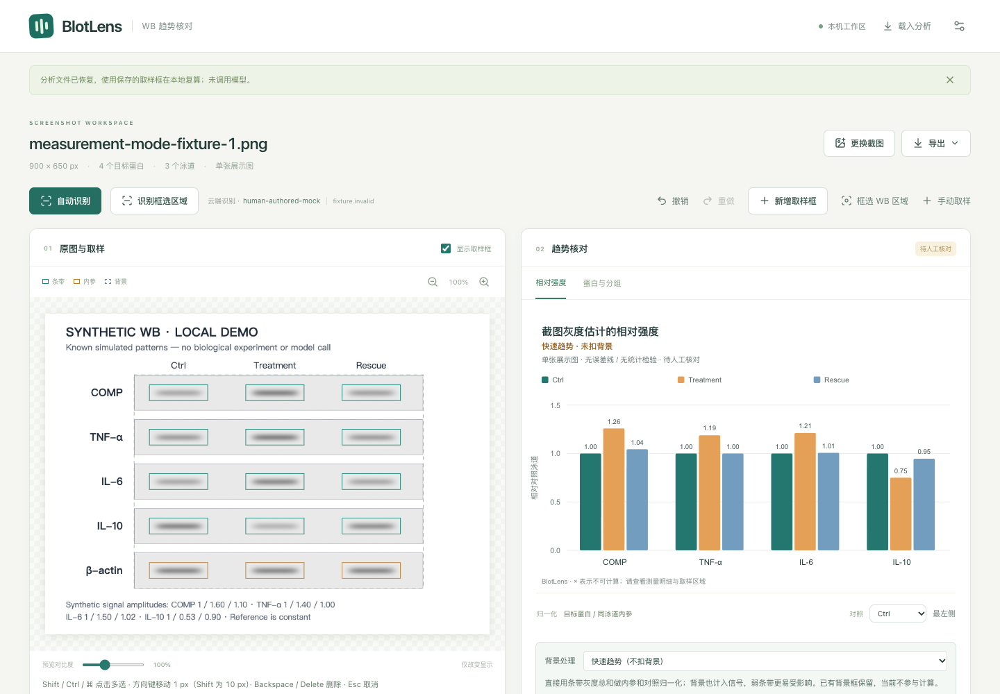

# 浏览器工作流验证

## 2026-10-11 配色与发布复测

四套预设与逐组颜色自定义已通过浏览器验证：图例／柱子同步、SVG 导出保留颜色、JSON 重载、撤销／重做及恢复预设均通过；测量内容与人工核对状态保持不变。TypeScript 与 production 构建通过，单元测试 **126/126**，完整浏览器回归 **37/37**（39.3 秒，含两张原截图的人工固定响应用例，无跳过）。当前数值评估 **77 项断言通过**；本次未重新运行外部 ImageJ，历史固定 ROI 对照证据保留原时间和源码哈希。未调用真实视觉模型。

## 2026-10-11 背景模式、区域识别与提示修订

最终 production 构建和 TypeScript 检查通过，单元测试 **126/126** 通过；完整 Chrome 回归 **36/36** 通过（38.6 秒），两张用户原截图的固定响应流程均运行，无跳过。端口 4317 已确认提供本次新构建，未重启保存 API 设置的服务。

新增验证包括：

- 明确切换扣背景／不扣背景，缺失背景时仅快速模式仍可计算；切换保留所有 ROI、可撤销／重做，JSON 重载与 CSV/SVG 模式标签一致。
- 邻近背景建议只填空缺，不移动条带、不覆盖已有背景；失败仍保留缺失，背景修复可撤销。
- 同行轻微重叠按每框交集并集面积判断，容差为 10%；旧文件保持严格规则，显式切换与撤销可复算。
- 新布局默认几何最左泳道，手工补框自动跟随；明确选择后保留，旧文件导入不重选，撤销保存选择方式。
- 选区识别实际发送 PNG 的逐通道像素与原图裁剪一致，不受预览对比度影响；模型坐标回映、完整原图／哈希保留和 `inputRegion` 记录正确。模型面板较小时，重复识别仍发送最初用户选区；取消或重新框选会丢弃迟到响应。
- 纯黑条带可以计算，深黑比例只作为默认折叠的可选信息；无“疑似截断”逐行警告，CSV 保留 `near_black_pixel_fraction`。黑色不作为曝光饱和诊断。

所有识别流程都使用人工固定响应，未调用真实供应商；这些结果证明软件行为与坐标映射，不证明视觉模型准确率。10% 重叠容差和自动背景候选尚未通过独立截图集验证。既有 ImageJ 固定 ROI 比较仅针对扣背景方法，不代表快速模式等同于 ImageJ 画基线的方法。



## 撤销与单框补充复测

最终 production 构建与 TypeScript 检查通过，单元测试 **68/68** 通过；完整 Chrome 浏览器回归 **28/28** 通过（27.6 秒，含两张原截图的固定响应流程），无跳过。

新增直接绘制条带与背景框、缺失泳道补框入口、50 步撤销／重做和快捷键。撤销保留完整审计历史，修改后会清空重做分支，换图或载入文件后从当前状态重新开始。单位测试验证快照还原、配对与边界校验、已有条带不移动、同行尺寸约束和安全背景建议。

浏览器新增覆盖删除及成组移动的撤销／重做、输入框原生按键行为、75% 缩放下的精准补框、已有条带不可重复添加、取消画框不产生数据、空白工作区新建蛋白／泳道、背景重叠后重新绘制，以及绘制中途撤销不会在松开鼠标时重新提交旧坐标。测试全部使用本地合成像素，识别调用被拦截。

## 2026-10-10 交互修订复测

本次针对多选、键盘操作、提示更新及缩小图片完成复测：TypeScript 与 production 构建通过，`reviewer:test` **50/50** 通过；Chrome 浏览器 **21/21** 通过（18.2 秒），包含下述原有 12 项及新增 9 项交互用例，两张原截图用例均运行，未跳过。仍使用固定识别响应，无真实模型调用。

新增覆盖 Shift/Ctrl/⌘ 多选和取消选择；整组拖动与方向键移动、边界处保持间距；背景索引安全删除和条带连带背景删除；输入框按键不触发删框；编辑后的 JSON 复算；缺失对照集中提示及 WB 区域修复；25%–300% 显示缩放、重置、数值不变及缩小后按原图像素移动。核心新增测试覆盖旧识别提示的清理、真实像素／背景问题保留，以及 CSV 当前提醒与原始识别备注分列。

当前 CSV 末尾增加 `recognition_notes`，保存初始备注；`warnings` 仅含当前测量提醒。分析 JSON 继续保存原始模型响应和编辑历史。

## 2026-10-10 本机记录

环境为 macOS、Node.js 22.22.0、Google Chrome **155.0.8059.39**。应用以本地 production 服务运行，Playwright 使用真实 Chrome 通道、1440 × 1000 视口和独立浏览器上下文。

执行命令如下；截图路径指向本次用户提供的本地临时文件，仓库中不包含这些图片：

```sh
BROWSER_CHANNEL=chrome \
WB_SAMPLE_1=/absolute/path/to/first-user-screenshot.png \
WB_SAMPLE_2=/absolute/path/to/second-user-screenshot.png \
npm run reviewer:e2e
```

最终运行 **12/12 测试通过**（12.9 秒），包括两个实际用户截图的可选用例；不是“10 通过、2 跳过”。原图分别用 fixture 内 SHA-256 核对来源。未指定两个环境变量时，这两个用例会明确跳过，不能据此宣称真实截图已覆盖。

本次用例验证：

- 合成图产生 15 条测量、12 个目标相对值；显示对比度变化不改变测量数值。
- 修改 ROI 后重新计算，同蛋白行同步宽高；清空内参配对只使对应蛋白不可计算，恢复后结果可用。
- 通过真实页面事件处理器完成剪贴板粘贴与拖放导入，生成 3 行 × 2 泳道人工取样网格，不调用模型。
- 每条条带达到 20 个背景区域后禁止继续添加；导出与重新导入仍然有效，编辑历史不会被超限状态污染。
- 柱状图 PNG/SVG、取样框叠图 PNG、CSV 和分析 JSON 导出；JSON 导入后按保存区域复算，得到相同测量内容，不重新调用识别服务。
- 配置中的测试 API key 不出现在所检查的导出内容、localStorage 或 sessionStorage。此用例不代表所有浏览器内存、代理进程或恶意服务的全面安全审计。
- 固定人工 mock 候选框的 5 × 2 / 5 × 3 场景中，改变面板外的模拟论文柱状图颜色后，测量明细不变；测量与背景框留在 WB 面板内。
- 识别错误保留当前图片和草稿；取消识别或更换图片后，晚到的旧识别响应不能覆盖当前工作。
- 两张真实用户截图可导入，配合人工 mock 候选框形成相应数量的条带，并在分析记录中保留 `human-authored-mock` 来源。

测试调用的视觉识别响应均由 Playwright 拦截提供。**没有真实模型调用，也没有测得自动识别准确率。** 实际截图测试仅证明该输入在给定人工候选框下的工作流，不证明自动定位、OCR 或截图定量的科学有效性。

上述浏览器运行结果不外推为 Windows、Safari、Firefox 或所有 Chrome 版本兼容。数值真值与独立 ImageJ 结果另见 [validation.md](validation.md)。

同次交付还通过 `reviewer:test` 的 **43 项测试**（含 8 项 JPEG 方向元数据检查）、TypeScript 与生产构建；原 Blot Workbench 的 18 项单元测试通过。新增 CI 工作流已配置，但此处不把尚未执行的远程 CI 算作已验证。

## 额外合成示例冒烟与截图

独立的 Chrome 页面在 production 端口 4317 载入本地合成示例，确认 15 条测量和 12 个有效目标柱、没有页面异常、没有 `/api/recognize` 请求，导出的分析 JSON 中 `recognition` 为 `null`。示例变化方向与设定的振幅相符；例如 COMP 约为 `1 / 1.5996 / 1.1028`，IL-10 约为 `1 / 0.5330 / 0.8993`。这是软件冒烟检查，不是生物实验。

下图于同日使用 Chrome 155、1440 × 1000 视口直接截取；内容全部为本地生成的合成示例，不包含用户论文图片：


截图是静态界面记录；不能单独作为算法、跨平台兼容或真实视觉模型效果的证据。
